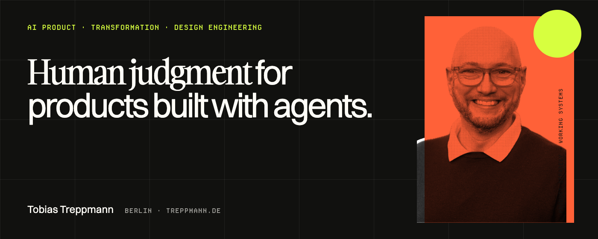
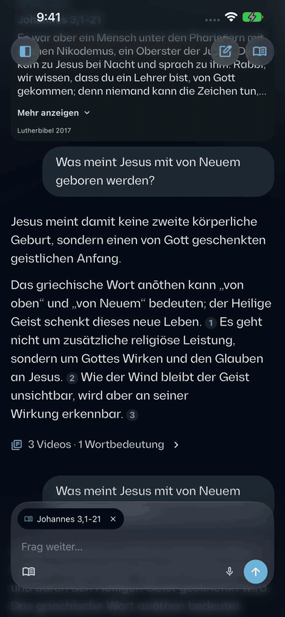
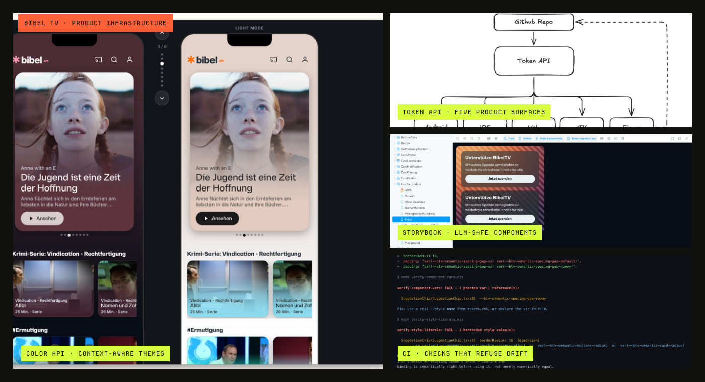
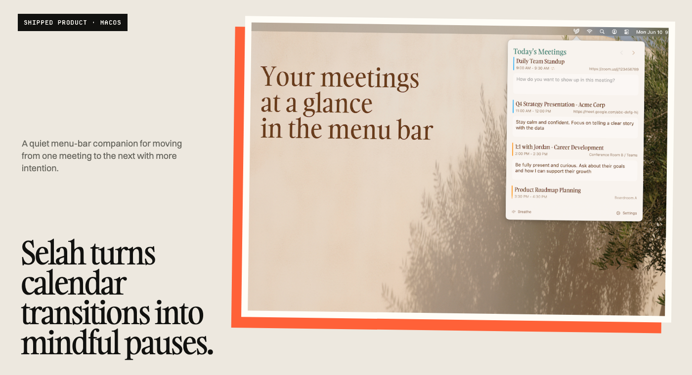
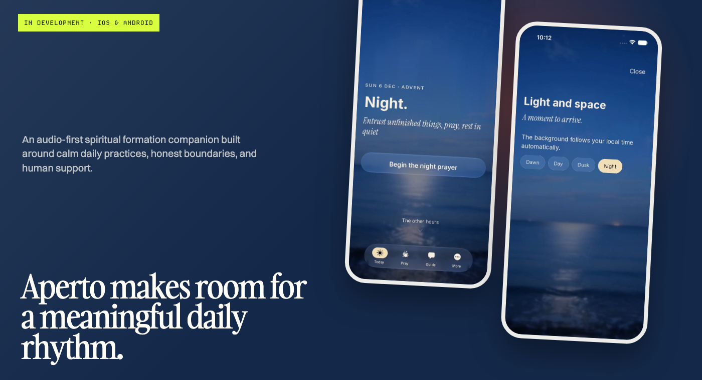
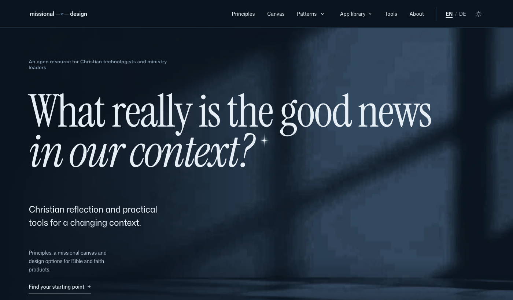
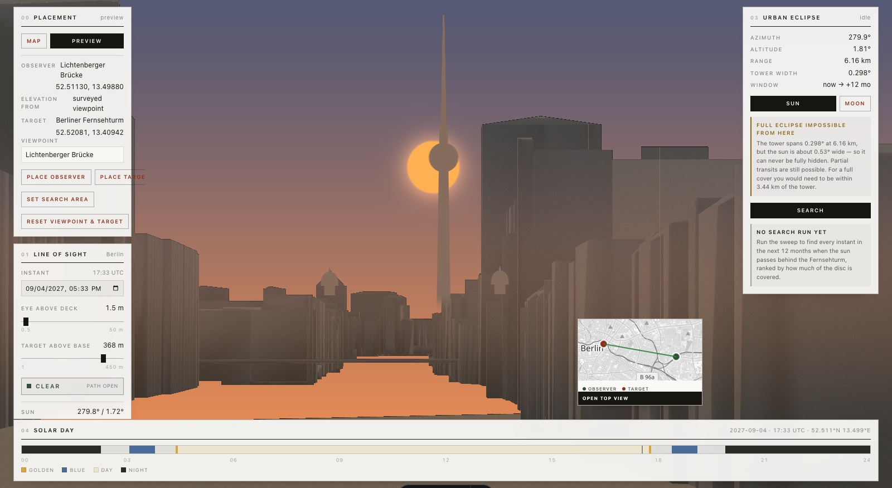

# Tobias Treppmann

**AI Product & Transformation Leader · Product Designer · Agentic Builder**

I turn complex workflows into useful AI-native products—and help teams adopt the
practices to build them. My work combines product strategy, human-centered design,
facilitation, and agentic engineering.

The common thread is deployment: find the actual bottleneck, connect the systems and
data around it, make the result usable, and leave behind a workflow that people can
understand and operate.

Based in Berlin. I work with product organizations that need to move from AI
experiments to valuable, usable systems without removing human judgment.

My work spans product leadership inside organizations, focused client engagements,
and independent ventures—from product strategy and research to production
infrastructure and shipped software.

[AI leadership & transformation](https://treppmann.de) ·
[Product design portfolio](https://treppmann.design) ·
[LinkedIn](https://www.linkedin.com/in/tobiastreppmann/) ·
[Email](mailto:tobias@treppmann.de)

## What I build

- **AI-native products** that make complex expertise and content useful to people.
- **Workflow tools and product infrastructure** that turn manual processes into
  maintainable systems.
- **Human–AI interaction models** that make delegation, review, provenance, and
  intervention understandable.
- **Team practices for agentic delivery**—from working prototypes and MCP-enabled
  environments to shared guidelines and responsible adoption.

## How I work in the field

1. **Find the leverage.** I work backward from the operator, the workflow, and the
   economic or mission value—not from a model demo.
2. **Build across boundaries.** I move between product framing, interfaces, APIs,
   data pipelines, agents, design systems, and deployment until the complete path
   works.
3. **Earn trust.** I make sources, uncertainty, review points, and human control
   visible, then help the people doing the work shape and adopt the system.

## Client and organization work

### [AI Bible Study App for Bibel TV](https://github.com/oratioandco/ai-bible-study-case-study)

**Bibel TV · AI product leadership, design, and implementation**

A source-grounded AI study Bible I designed, managed, and built for Bibel TV. The
operational bottleneck was not a missing chatbot; it was making a large long-form
video catalog useful at the moment someone reads a passage or asks a question. The
resulting system connects native reading, grounded conversation, retrieval, and
source-linked virtual clips to a nightly catalog sync and a continuously running
content workflow. By October 2026, the pipeline contained 11,405 source-linked clips
from 3,504 videos.

### Bibel TV product infrastructure

**Bibel TV · Production infrastructure across product surfaces**

I built the infrastructure that lets product teams move quickly without losing
coherence: a live Color API for context-aware artwork themes; a four-tier token
system distributed through an API to Android, iOS, web, connected TV, and Figma;
an LLM-safe Storybook component reference; and six local and CI checks that refuse
unresolved token references and hardcoded color values. A matching MCP and CLI give
coding agents the system's real tokens, components, screen decisions, and scaffolds
instead of asking them to approximate the design language from screenshots. This
turns agentic delivery from isolated prompting into a governed workflow the product
team can actually share.

### Earlier organization work

Earlier roles and engagements span Ninox, Datameer, ChurchDesk, and Hypoport Hub SE—
across B2B SaaS, enterprise analytics, workflow productization, design-system
governance, and organizational change. The fuller case-study portfolio is available
at [treppmann.design](https://treppmann.design).

## Independent products and ventures

### [Selah — mindful calendar transitions](https://selah.guide)

**Independent product · Shipped on the Mac App Store**

A shipped macOS menu-bar app that turns the gaps between meetings into intentional
pauses. I designed and agentically engineered the product end to end, integrating
EventKit calendars, system notifications, meeting-link detection, breathing and
reflection flows, and privacy-conscious local storage into the rhythms of an
existing workday. [View it on the Mac App Store](https://apps.apple.com/us/app/selah-mindful-transitions/id6748382447?mt=12).

### Aperto — spiritual formation companion

**Independent venture · Native product for iOS and Android**

An audio-first native companion for people seeking a meaningful daily spiritual
rhythm. The product combines calm practices, conversational support, Scripture,
multilingual content, and deliberately human-centered safety boundaries. Its
personalization system learns over time while keeping the daily practice calm,
legible, and under the person's control.

### [Missional by Design — open research and practice](https://missional.design)

**Independent open venture · Live in English and German**

An open, bilingual resource for Christian technologists and ministry leaders,
combining design principles, a missional canvas, product patterns, and a research
library for Bible, faith, and AI products. Its public, stateless
[Bezalel MCP server](https://patterns.missional.design/bezalel/) brings the same
options, evidence, and questions into Claude, ChatGPT, Cursor, and other compatible
assistants. It is a practical example of putting domain research inside the tools
where decisions happen while leaving theological, pastoral, and safeguarding
judgment to people.

## Selected products and systems

### [Urban Eclipse](https://github.com/oratioandco/urbaneclipse)

A 3D geospatial planning tool for extreme-telephoto photography. It turns official
CityGML, coordinate and height-datum conversion, non-convex building geometry,
camera math, ephemeris data, and line-of-sight checks into a tested
CityGML-to-3D-Tiles pipeline and a deployed planning instrument with a top-down route
view and an inspectable camera composition.

### [Waldläufer](https://github.com/oratioandco/waldlaeufer)

An adaptive learning game for children with dyslexia that turns reading practice into
a navigable 3D forest experience. The product combines learning design, game mechanics,
an adaptive practice engine, and an end-to-end browser implementation. It translates
specialist learning principles into moment-to-moment scaffolding, parent or therapist
reporting, and a working iPad Safari experience while keeping learning data on the
device.

### [Dynamic Identity Configurator](https://github.com/oratioandco/dynamic_identity_configurator)

A generative identity system that turns one architectural form into an extensible
family of distinctive posters. It productizes a recurring creative-production
workflow: brand constraints become parameters, variations become reproducible, and
non-designers can make new material through a usable interactive configurator.
[Try the configurator](https://oratioandco.github.io/dynamic_identity_configurator/).

### [Aperto Bible](https://github.com/oratioandco/aperto-bible)

An open, multilingual publishing system exploring how AI-assisted translation can
remain inspectable and human-governed across languages, structured content, and
reusable distribution formats. Its value is the workflow around the model: stable
source structure, reviewable changes, provenance, and outputs that can be reused
without hiding how they were produced.

Faith App Foundation is the shared product platform I am building for the Bible-study
and spiritual-formation tracks: reusable content, conversation, safety, media, and
personalization capabilities designed to let distinct products share infrastructure
without collapsing into the same experience.

## How I work

I start with the work people are actually trying to accomplish. Then I move between
research, product framing, interaction and system design, facilitation, and working
software until the idea is concrete enough to test—and robust enough for a team to
continue.

I use AI as part of the delivery system, not as a substitute for product judgment.
That means making assumptions visible, keeping people in control, testing against real
workflows, and designing the operating model around the technology as carefully as the
interface.

## Current focus

I am building AI-native products and reusable workflow systems across media, spiritual
formation, creative work, and photography—while helping teams develop the confidence,
governance, and practical habits to ship meaningful AI-enabled work.

If that intersects with a problem you are working on, [let’s talk](mailto:tobias@treppmann.de).
