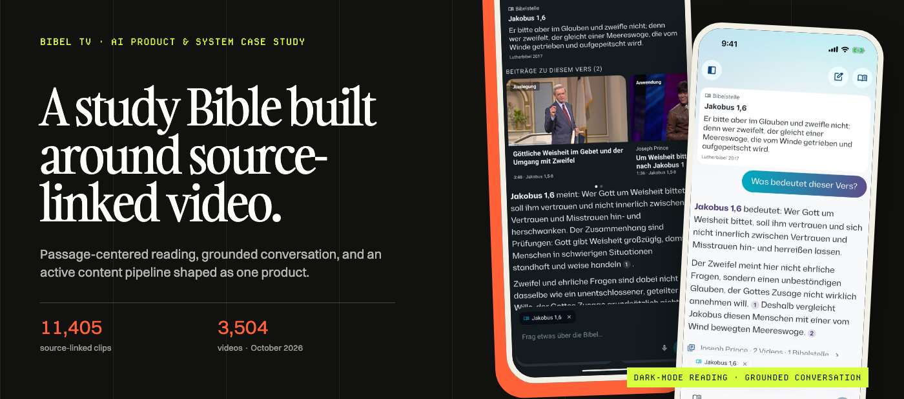
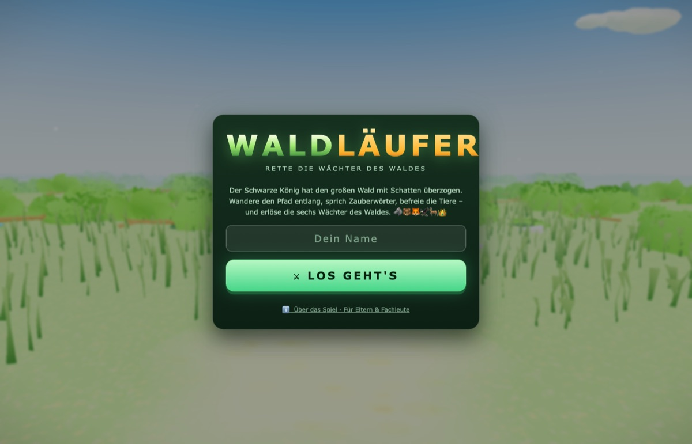
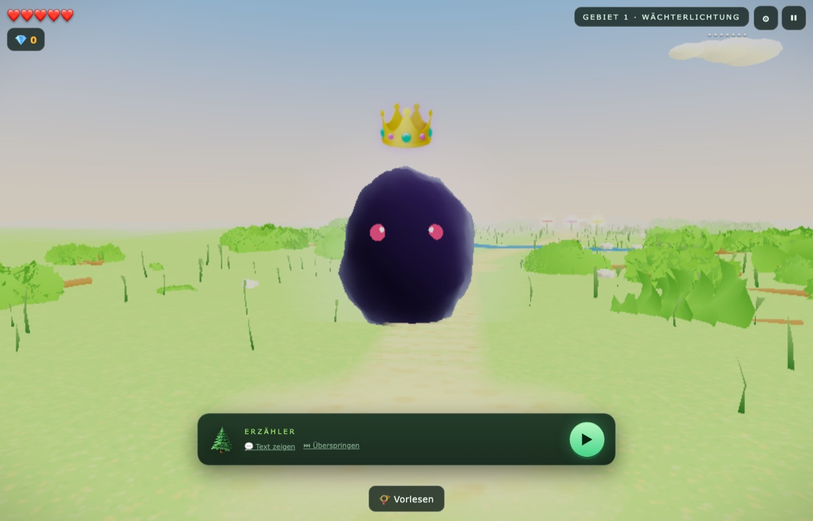

# Tobias Treppmann

**AI Product & Transformation Leader · Product Designer · Agentic Builder**

I turn complex workflows into useful AI-native products—and help teams adopt the
practices to build them. My work combines product strategy, human-centered design,
facilitation, and agentic engineering.

Based in Berlin. I work with product organizations that need to move from AI
experiments to valuable, usable systems without removing human judgment.

My work spans product leadership inside organizations, focused client engagements,
and independent ventures—from production infrastructure and shipped products to
deliberate early-stage experiments.

[AI leadership & transformation](https://treppmann.de) ·
[Product design portfolio](https://treppmann.design) ·
[LinkedIn](https://www.linkedin.com/in/tobiastreppmann/) ·
[Email](mailto:tobias@treppmann.de)

## What I build

- **AI-native products** that make complex expertise and content useful to people.
- **Workflow tools and product infrastructure** that turn manual processes into
  maintainable systems.
- **Human–AI interaction models** that make delegation, review, provenance, and
  intervention understandable.
- **Team practices for agentic delivery**—from working prototypes and MCP-enabled
  environments to shared guidelines and responsible adoption.

## Client and organization work

### [AI Bible Study App for Bibel TV](https://github.com/oratioandco/ai-bible-study-case-study)

**Bibel TV · Product leadership, design, and implementation · Test builds**

The product and system story behind an unpublished, source-grounded AI study
Bible I designed, managed, and built for Bibel TV. It combines a calm native
reading experience, grounded conversation, virtual clips, retrieval architecture,
and agentic content workflows. An October 2026 pipeline snapshot contained 11,405
source-linked clips from 3,504 videos; this is system output, not an adoption
claim. The app runs in test builds and has not launched.

### Bibel TV product infrastructure

**Bibel TV · Production infrastructure across product surfaces**

I built the infrastructure that lets product teams move quickly without losing
coherence: a live Color API for context-aware artwork themes; a four-tier token
system distributed through an API to Android, iOS, web, connected TV, and Figma;
an LLM-safe Storybook component reference; and six local and CI checks that refuse
unresolved token references and hardcoded color values. A matching MCP and CLI give
coding agents the system's real tokens, components, screen decisions, and scaffolds
instead of asking them to approximate the design language from screenshots.

### Earlier organization work

Earlier roles and engagements span Ninox, Datameer, ChurchDesk, and Hypoport Hub SE—
across B2B SaaS, enterprise analytics, workflow productization, design-system
governance, and organizational change. The fuller case-study portfolio is available
at [treppmann.design](https://treppmann.design).

## Independent products and ventures

### [Selah — mindful calendar transitions](https://selah.guide)

**Independent product · Shipped on the Mac App Store**

A shipped macOS menu-bar app that turns the gaps between meetings into intentional
pauses. I designed and agentically engineered the product end to end, including its
privacy-conscious on-device experience. [View it on the Mac App Store](https://apps.apple.com/us/app/selah-mindful-transitions/id6748382447?mt=12).

### Aperto — spiritual formation companion

**Independent venture · In active development for iOS and Android**

An audio-first native companion for people seeking a meaningful daily spiritual
rhythm. The product combines calm practices, conversational support, Scripture,
multilingual content, and deliberately human-centered safety boundaries. Aperto is
in active development for iOS and Android and has not launched.

### [Missional by Design — open research and practice](https://missional.design)

**Independent open venture · Live in English and German**

An open, bilingual resource for Christian technologists and ministry leaders,
combining design principles, a missional canvas, product patterns, and a research
library for Bible, faith, and AI products. Its public, stateless
[Bezalel MCP server](https://patterns.missional.design/bezalel/) brings the same
options, evidence, and questions into Claude, ChatGPT, Cursor, and other compatible
assistants—while leaving theological, pastoral, and safeguarding judgment to people.

## Product experiments and open work

### [Urban Eclipse](https://github.com/oratioandco/urbaneclipse)

A 3D geospatial planning tool for extreme-telephoto photography. It combines real
Berlin LoD2 buildings, astronomical calculations, camera geometry, line-of-sight
analysis, and a tested CityGML-to-3D-Tiles pipeline in a distinctive plaster-model
interface. [Open the live experience](https://plastervoid-n.2.28.29.90.sslip.io).

### [Waldläufer](https://github.com/oratioandco/waldlaeufer)

  
  

An adaptive learning game for children with dyslexia that turns reading practice into
a navigable 3D forest experience. The product combines learning design, game mechanics,
and an end-to-end browser implementation.

### [Dynamic Identity Configurator](https://github.com/oratioandco/dynamic_identity_configurator)

A generative identity system that turns one architectural form into an extensible
family of distinctive posters—connecting brand rules, creative tooling, and a usable
interactive configurator. [Try the configurator](https://oratioandco.github.io/dynamic_identity_configurator/).

### [Aperto Bible](https://github.com/oratioandco/aperto-bible)

An open, multilingual publishing system exploring how AI-assisted translation can
remain inspectable and human-governed across languages, structured content, and
reusable distribution formats.

Faith App Foundation is the shared application foundation I am currently developing
across the Bible-study and spiritual-formation product tracks. It is not presented as
a finished product yet.

## How I work

I start with the work people are actually trying to accomplish. Then I move between
research, product framing, interaction and system design, facilitation, and working
software until the idea is concrete enough to test—and robust enough for a team to
continue.

I use AI as part of the delivery system, not as a substitute for product judgment.
That means making assumptions visible, keeping people in control, testing against real
workflows, and designing the operating model around the technology as carefully as the
interface.

## Current focus

I am building AI-native products and reusable workflow systems across media, spiritual
formation, creative work, and photography—while helping teams develop the confidence,
governance, and practical habits to ship meaningful AI-enabled work.

If that intersects with a problem you are working on, [let’s talk](mailto:tobias@treppmann.de).
